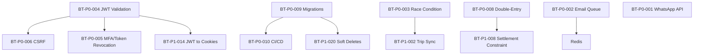

# VERIFIED REMEDIATION ROADMAP - Bihar Transport

**Audit Date:** 2026-10-31  
**Status:** AUDIT ONLY - Implementation requires explicit approval  
**Total Issues:** 40 (12 P0 + 28 P1)  
**Estimated Timeline:** 8 weeks to production-ready  
**Overall Readiness Target:** ≥ 85/100

---

## Implementation Priority Order

Based on risk and dependencies:
1. **Financial Data Integrity** (Highest)
2. **Authentication & Authorization**
3. **Database Integrity**
4. **Booking & Trip Concurrency**
5. **Document & POD Enforcement**
6. **External Integration Reliability**
7. **Deployment & Backup Safety**

---

## PHASE 0: CRITICAL BLOCKERS (Week 1) - P0 Financial/Auth/DB

### Sprint 0.1: Financial Data Integrity (Days 1-2) - PRIORITY 1
| ID | Task | Severity | Files | Est. | Dependencies |
|---|---|---|---|---|---|
| BT-P0-008 | Add double-entry validation constraints/triggers on FinancialTransaction | P0 | `prisma/schema.prisma`, migration | 2 days | None |
| BT-P0-007 | Add settlement arithmetic CHECK constraint (gross - commission - expenses = net_payable) | P0 | `prisma/schema.prisma` (Settlement), migration | 1 day | None |

**Deliverable:** Database-level financial integrity enforced

### Sprint 0.2: Authentication Hardening (Days 2-4) - PRIORITY 2
| ID | Task | Severity | Files | Est. | Dependencies |
|---|---|---|---|---|---|
| BT-P0-004 | Enforce JWT_SECRET entropy/length validation, fail fast | P0 | `server.js`, `utils/env.js`, `middleware/auth.js` | 0.5 days | None |
| BT-P0-006 | Implement CSRF protection on state-changing endpoints | P0 | `server.js`, middleware | 1.5 days | BT-P0-004 (cookies strategy) |
| BT-P0-005 | Add MFA for admin + token blocklist + short-lived tokens | P0 | `middleware/auth.js`, auth routes/services, Redis | 2 days | BT-P0-004 |

**Deliverable:** Secure authentication foundation

### Sprint 0.3: Database Integrity & Concurrency (Days 4-7) - PRIORITY 3 & 4
| ID | Task | Severity | Files | Est. | Dependencies |
|---|---|---|---|---|---|
| BT-P0-009 | Clean migration history, make schema.prisma source of truth, CI gate | P0 | migrations/, CI | 2 days | None |
| BT-P0-003 | Fix Enquiry→Booking race condition with atomic transaction/locks | P0 | `EnquiryService.js`, `BookingService.js` | 1.5 days | None |
| BT-P1-018 | Centralize advisory lock acquisition with consistent ordering | P1 | `TripService.js`, `VehicleHireWorkflowService.js`, new utility | 1 day | BT-P0-003 |

**Deliverable:** Data integrity and concurrency safety

**Week 1 Total:** ~11 days effort (parallelizable)

---

## PHASE 1: POD, INTEGRATIONS & RBAC (Week 2)

### Sprint 1.1: Document & POD Enforcement (Days 1-3) - PRIORITY 5
| ID | Task | Severity | Files | Est. | Dependencies |
|---|---|---|---|---|---|
| BT-P0-007 | Enforce POD verification before DELIVERED status | P0 | `TripService.js`, `TripStateMachine.js` | 2 days | None |
| BT-P1-004 | Migrate vehicle document dates from TEXT to DATE with validation | P1 | schema, migration, `VehicleHireWorkflowService.js` | 1 day | None |
| BT-P1-006 | Validate driver license expiry before trip assignment | P1 | `DriverManagementService.js` | 0.5 days | None |

**Deliverable:** Compliance enforcement

### Sprint 1.2: RBAC & Security Hardening (Days 3-5)
| ID | Task | Severity | Files | Est. | Dependencies |
|---|---|---|---|---|---|
| BT-P1-001 | Implement granular RBAC for operator role | P1 | `middleware/auth.js`, route protections | 1 day | None |
| BT-P1-022 | Password strength policy | P1 | auth controllers/services | 0.5 days | BT-P0-004 |
| BT-P1-023 | Account lockout after failed attempts | P1 | auth routes/services | 0.5 days | None |
| BT-P1-024 | Session absolute timeout | P1 | auth middleware | 0.5 days | BT-P0-004, BT-P0-005 |

**Deliverable:** Proper access control

### Sprint 1.3: Integrations (Days 5-7) - PRIORITY 6
| ID | Task | Severity | Files | Est. | Dependencies |
|---|---|---|---|---|---|
| BT-P0-002 | Implement email queue with retry/DLQ | P0 | `emailService.js`, `EnquiryService.js`, `BookingService.js`, Redis/BullMQ | 2 days | Redis setup |
| BT-P0-001 | Implement WhatsApp Cloud API sending | P0 | `server.js`, new WhatsApp service | 1.5 days | API credentials |

**Deliverable:** Reliable notifications

**Week 2 Total:** ~9.5 days

---

## PHASE 2: OBSERVABILITY, FRONTEND SECURITY & DATA QUALITY (Week 3)

### Sprint 2.1: Observability (Days 1-3)
| ID | Task | Severity | Files | Est. | Dependencies |
|---|---|---|---|---|---|
| BT-P1-010 | Add OpenTelemetry distributed tracing | P1 | `server.js`, services | 1.5 days | None |
| BT-P1-011 | Add Prometheus business metrics | P1 | `server.js`, metrics service | 1 day | None |
| BT-P1-012 | Configure log rotation | P1 | `utils/logger.js` | 0.5 days | None |
| BT-P1-013 | Health checks for external dependencies | P1 | `server.js` (/api/ready) | 0.5 days | None |

**Deliverable:** Production observability

### Sprint 2.2: Frontend Security & UX (Days 3-5)
| ID | Task | Severity | Files | Est. | Dependencies |
|---|---|---|---|---|---|
| BT-P1-014 | Move JWT from localStorage to httpOnly cookies | P1 | `frontend/src/services/api.js`, backend auth | 1.5 days | BT-P0-004, BT-P0-006 |
| BT-P1-015 | Add per-endpoint timeouts and retry with backoff | P1 | `frontend/src/services/api.js` | 0.5 days | None |
| BT-P1-016 | Apply ErrorBoundary to all routes | P1 | `App.jsx`, components | 0.5 days | None |

**Deliverable:** Secure frontend

### Sprint 2.3: Data Quality & API Hardening (Days 5-7)
| ID | Task | Severity | Files | Est. | Dependencies |
|---|---|---|---|---|---|
| BT-P1-005 | GST/PAN validation | P1 | schema validation, services | 0.5 days | None |
| BT-P1-007 | Partner payment idempotency | P1 | `PartnerService.js`, routes | 0.5 days | None |
| BT-P1-008 | Settlement net_payable DB constraint | P1 | schema migration | 0.5 days | BT-P0-007 |
| BT-P1-026 | Global search query length validation & rate limiting | P1 | `adminRoutes.js` | 0.5 days | None |
| BT-P1-027 | Role-scoped search results | P1 | `adminRoutes.js` | 0.5 days | BT-P1-001 |
| BT-P1-028 | Pagination enforcement on admin endpoints | P1 | `adminRoutes.js` | 0.5 days | None |

**Deliverable:** Data integrity & API safety

**Week 3 Total:** ~8 days

---

## PHASE 3: INFRASTRUCTURE, BACKUPS & DEPLOYMENT (Week 4+) - PRIORITY 7

### Sprint 3.1: Database Performance & Safety (Days 1-3)
| ID | Task | Severity | Files | Est. | Dependencies |
|---|---|---|---|---|---|
| BT-P1-019 | Configure Prisma connection pooling | P1 | `prisma/schema.prisma`, `config/prisma.js` | 0.5 days | None |
| BT-P1-020 | Add soft deletes to critical tables | P1 | schema migration, repositories | 2 days | BT-P0-009 |
| BT-P1-002 | Fix Enquiry→Trip sync with compensating transaction/outbox | P1 | `EnquiryService.js` | 1 day | BT-P0-003 |
| BT-P1-003 | Rate limiting on public tracking endpoint | P1 | `bookingRoutes.js`, `server.js` | 0.5 days | None |

**Deliverable:** DB resilience

### Sprint 3.2: Deployment & Containerization (Days 3-5)
| ID | Task | Severity | Files | Est. | Dependencies |
|---|---|---|---|---|---|
| BT-P0-011 | Create Dockerfiles (backend/frontend) and docker-compose | P0 | Dockerfiles, docker-compose.yml | 2 days | None |
| BT-P0-010 | Complete CI/CD pipeline (lint/test/build/security/deploy) | P0 | `.github/workflows/` | 2 days | BT-P0-009 |
| BT-P1-017 | Refactor large page files (AdminBookings.jsx, AdminOrders.jsx) | P1 | Frontend components | 1.5 days | None |

**Deliverable:** Containerized, automated deployments

### Sprint 3.3: Backups & Operations (Days 5-7)
| ID | Task | Severity | Files | Est. | Dependencies |
|---|---|---|---|---|---|
| BT-P0-012 | Automated backups to S3 with PITR | P0 | Backup scripts, cron | 2 days | None |
| BT-P1-009 | Google Maps rate limiting/caching/circuit breaker | P1 | `mapsController.js`, `distanceMatrix.js`, Redis | 1.5 days | Redis |
| BT-P1-021 | File upload sanitization (type/size validation, virus scan) | P1 | Upload middleware/routes | 1 day | ClamAV or service |

**Deliverable:** Operational safety

**Week 4 Total:** ~12 days

---

## Critical Path Dependencies

---

## Risk Assessment

| Risk | Likelihood | Impact | Mitigation |
|---|---|---|---|
| Migration issues during cleanup | High | High | Test on staging copy, have rollback scripts |
| Race condition fix breaks flow | Medium | High | Extensive concurrency testing |
| Auth changes break existing sessions | Medium | High | Gradual rollout, backward compatibility |
| Redis dependency for queues/blocklist | Medium | Medium | Fallback mechanisms |
| Third-party API changes (WhatsApp/Maps) | Low | Medium | Circuit breakers, graceful degradation |

---

## Testing Strategy

- **Unit Tests:** State machines, financial calculations, validations
- **Integration Tests:** End-to-end flows, race conditions
- **Security Tests:** CSRF, auth bypass, injection
- **Load Tests:** Concurrency, payment flows
- **Chaos Tests:** DB failures, external API failures
- **Migration Tests:** Up/down migrations
- **Restore Tests:** Backup/restore drills

---

## Success Metrics

| Metric | Current | Target | Status Check |
|---|---|---|---|
| P0 Issues Resolved | 0/12 | 12/12 | All critical fixed |
| P1 Issues Resolved | 0/28 | < 5 remaining | Major issues addressed |
| Security Score | ~42/100 | ≥ 80/100 | Auth, CSRF, secrets fixed |
| Financial Integrity | Failing | Passing | Double-entry enforced |
| Test Coverage | ~45% | ≥ 80% | Critical paths covered |
| Deployment Automation | None | Full CI/CD | Automated pipeline |
| Backup/Recovery | None | Tested | RTO < 4h, RPO < 1h |

---

## Recommendation

**DO NOT DEPLOY TO PRODUCTION** until all P0 issues are resolved and tested. Focus on Phase 0 first, especially BT-P0-004 (JWT validation), BT-P0-008 (financial integrity), and BT-P0-003 (race condition). These are blocking issues with highest business impact.

**First Task:** BT-P0-004 - JWT_SECRET validation (0.5 days, no dependencies, foundational)
**Approval Required:** Explicit approval needed before starting any implementation.
